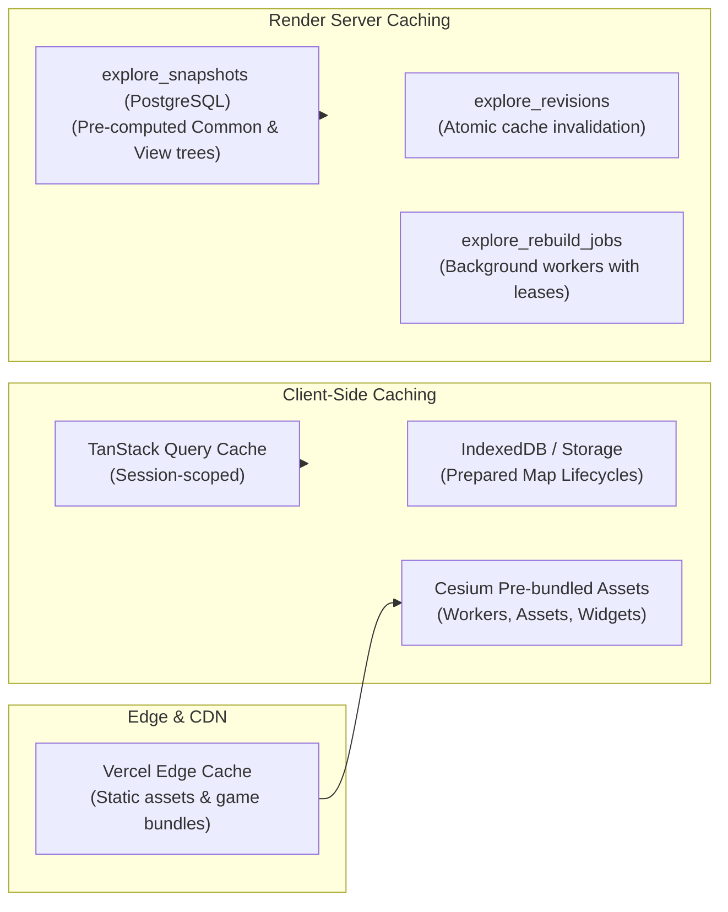

# Caching and Performance Architecture

The **Personal Learning Ground** platform combines heavy 3D globe visualizations (CesiumJS) with a rich geographic knowledge catalog containing thousands of historical, cultural, and scientific landmarks. To maintain 60 FPS rendering on laptops and iPads, the system employs a multi-tiered caching and data bounding architecture.

---

## ⚡ Performance Optimization Pillars

---

## 🗺️ Explore Catalog Snapshots (`explore_snapshots`)

Rather than performing costly spatial clustering and GeoJSON point-in-polygon queries on every map request, the backend materializes optimized **Explore Snapshots**:

1. **Snapshot Kinds**:
   - `common`: Pre-calculated base cluster hierarchies and global landmark trees shared across all families.
   - `view`: Tailored views accounting for visibility filters, custom family lessons, and disabled content.
2. **Atomic Revisioning (`explore_revisions`)**:
   - A singleton row tracks `catalog_revision` and `visibility_revision`.
   - When an admin updates catalog content or imports new landmarks, `catalog_revision` increments atomically.
   - Client requests carry the current revision; responses return `304 Not Modified` or load pre-built JSON blobs without re-querying relational tables.
3. **Background Rebuilds (`explore_rebuild_jobs`)**:
   - Heavy snapshot rebuilds run asynchronously using distributed leases (`lease_until`) to avoid duplicate concurrent calculations.
   - Snapshots are compressed into bounded JSONB payloads (capped at 8MB).

---

## 🌍 CesiumJS 3D Asset Pipeline

Cesium requires significant static assets (Web Workers, terrain models, star textures, widget stylesheets) that can easily cause performance bottlenecks if misconfigured:

1. **Custom Vite Asset Plugin**:
   - `frontend/vite.config.ts` incorporates a dedicated plugin copying Cesium runtime assets directly into `dist/client/cesium/{Workers,Assets,ThirdParty,Widgets}`.
   - Eliminates external CDN roundtrips and prevents version mismatch glitches.
2. **Terrain & Tile Optimization**:
   - Viewport bounding queries (`/api/v1/items/map/views?min_lat=...&max_lat=...`) stream only clusters relevant to current camera altitude and bounding frustum.
   - Drill-down leaves (`/api/v1/items/map/clusters/:node/leaves`) are fetched on-demand when the user zooms in past the cluster threshold.

---

## 🔄 TanStack Query Lifecycle & Memory Guard

- **Session Generation Tracking**:
  - The frontend monitors `sessionGeneration` in `useFamilyStore`.
  - When switching families or logging out, `clearPrivateQueryCache(queryClient)` immediately purges confidential child progress, calendar lists, and friend feeds from browser memory.
- **Deduplication & Request Guards**:
  - `latestRequestGuard.ts` prevents stale asynchronous responses from overwriting newer map camera positions or search filters.

---

## 🧭 Navigation & Cross References
- System Overview: [[01-architecture/overview|System Architecture Overview]]
- Catalog Endpoints: [[06-api-reference/catalog-and-explore-routes|Catalog and Explore Routes]]
- Database Snapshots Schema: [[05-database/tables-reference|Database Tables Reference (explore_snapshots)]]
- Local UAT Launcher: [[08-development-and-ops/local-development|Local Development and UAT]]
