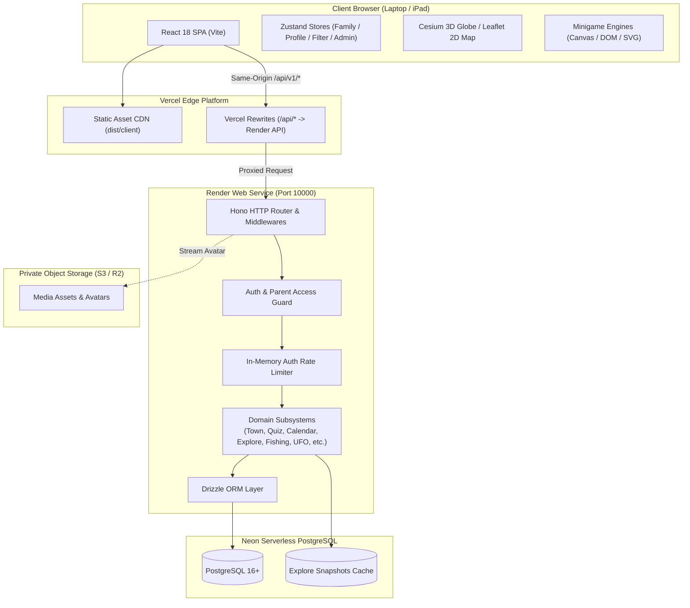

# System Architecture Overview

The **Personal Learning Ground** platform is architected as a modern, decoupled web application composed of three primary tiers:

1. **Frontend Tier (Vercel)**: A Single Page Application (SPA) built with React 18, Vite, TypeScript, and Tailwind CSS. Hosted on Vercel Edge/Serverless infrastructure with same-origin API proxy rewrites.
2. **Application API Tier (Render)**: A high-performance, stateless HTTP service built with Node.js 20+, TypeScript, and Hono. Hosted as a Web Service on Render.
3. **Database Tier (Neon PostgreSQL)**: A managed, serverless PostgreSQL 16+ database on Neon accessed via Drizzle ORM over pooled connection strings.
4. **Storage Tier (Cloud Object Storage / S3 / R2)**: Storage for custom user-uploaded avatars and catalog assets.

---

## 🏛️ High-Level System Architecture

---

## ⚙️ Core Technology Stack

| Layer | Technology | Key Capabilities & Justification |
| :--- | :--- | :--- |
| **Frontend Framework** | **React 18** | Functional components, Hooks, Suspense for code-splitting lazy routes. |
| **Build Tool** | **Vite 5** | Instant hot module replacement (HMR), optimized production builds, custom Cesium asset-copy plugin. |
| **Language** | **TypeScript 5.x** | Strict typing with `noUncheckedIndexedAccess`, zero unchecked indexing vulnerabilities. |
| **State Management** | **Zustand** | Lightweight client stores (`familyStore`, `profileStore`, `filterStore`, `adminStore`) with minimal boilerplate. |
| **Server Cache** | **TanStack React Query v5** | Server-state caching, automatic invalidation, and session-scoped query cache lifecycle. |
| **Mapping & 3D** | **CesiumJS & Leaflet** | 3D interactive globe with historical era grouping, customized terrain/imagery, and fast 2D fallback. |
| **Styling** | **Tailwind CSS & CSS Modules** | Utility-first CSS, custom responsive layouts, iPad landscape zero-scroll constraints. |
| **Server Framework** | **Hono** | Lightweight, ultra-fast web framework with built-in Web Standards compliance (Request / Response). |
| **Runtime** | **Node.js 20+ LTS** | Modern asynchronous I/O, native crypto APIs (`randomUUID`, `crypto.subtle`), standard web streams. |
| **ORM / Query Builder** | **Drizzle ORM** | Type-safe SQL schema definitions, zero runtime query generation overhead, explicit migrations. |
| **Database** | **Neon PostgreSQL** | Serverless Postgres with connection pooling, branching, and JSONB document support. |
| **Authentication** | **Argon2id & SimpleWebAuthn** | Robust password hashing, WebAuthn/FIDO2 passkeys, Google OAuth PKCE flow, and secure HttpOnly cookie sessions. |
| **Testing** | **Vitest & Playwright** | Fast unit/integration tests with Vitest; end-to-end multi-viewport browser testing with Playwright. |

---

## 🌐 Network Boundary & Same-Origin Strategy

In compliance with **ADR-002**, browser requests never talk directly to third-party databases or disparate API hosts:

1. **Same-Origin Requests**:
   - The browser connects solely to `https://<domain>` (or `http://localhost:5173` in local UAT).
   - All API calls use relative paths (`/api/v1/...`).
   - Vercel's `vercel.json` rewrites `/api/:path*` to the backend endpoint on Render (`https://api.<domain>/api/:path*`).
2. **Secure Cookie Handling**:
   - Authentication relies on the `session_token` cookie configured as `HttpOnly; SameSite=Lax; Secure; Path=/`.
   - JavaScript code never has direct access to the raw session secret, mitigating Cross-Site Scripting (XSS) credential theft.
3. **Host & Origin Validation**:
   - The Hono API on Render validates the `Origin` header against an explicit whitelist of allowed origins (`ALLOWED_ORIGINS`).
   - Host headers are strictly validated against `ALLOWED_HOSTS` to prevent DNS rebinding attacks.

---

## 🧭 Navigation & Cross References
- Security model and authentication flows: [[01-architecture/security-and-auth|Security and Authentication]]
- Architecture Decision Records: [[01-architecture/adrs-and-decisions|Architecture Decision Records]]
- Explore performance and snapshot caching: [[01-architecture/caching-and-performance|Caching and Performance]]
- Codebase layout: [[03-codebase-structure/repository-layout|Repository Layout]]
