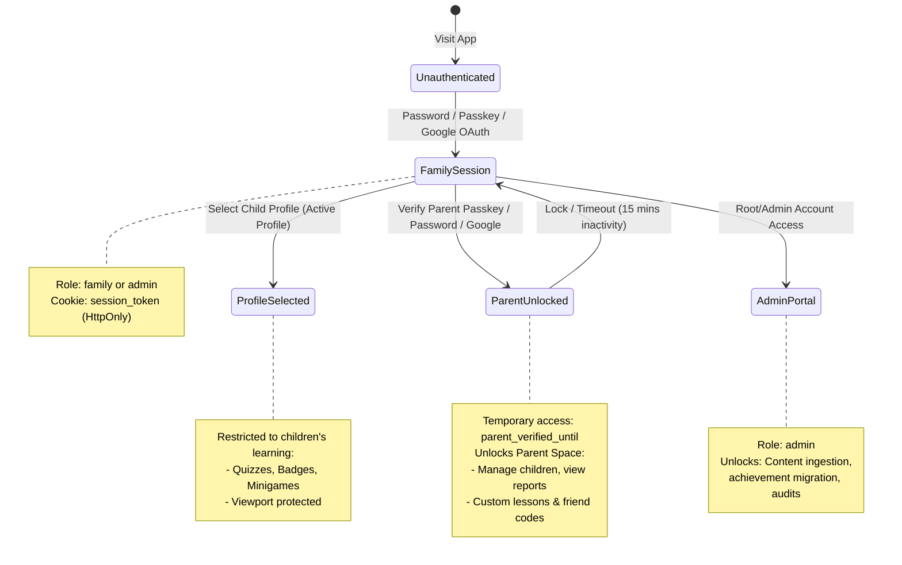

# Security and Authentication Model

The security model of **Personal Learning Ground** enforces strict isolation between child players, parent administrators, and system operators. The backend adheres to zero-trust principles: client-provided identity, progress, role, and scores are never trusted without server-side verification.

---

## 🔐 Authentication Tiers & Roles



---

## 🍪 Session Architecture & Cookie Isolation

1. **Session Secret**:
   - On successful authentication, the server generates a cryptographically secure random session token (`randomUUID()`).
   - The token is sent to the client in an `HttpOnly`, `SameSite=Lax`, `Secure` (in production) cookie named `session_token`.
2. **Server-Side Token Hashing**:
   - The plain token is **never stored in plaintext** in the database.
   - The database stores `tokenHash = sha256(session_token)` in the `sessions` table.
   - Even if the database is read, active session tokens cannot be spoofed.
3. **Session Expiry**:
   - Sessions expire after a configurable duration (default: 30 days).
   - Inactive or expired sessions are cleaned up or rejected on verification.

---

## 🔑 Passkeys (WebAuthn / FIDO2)

The application provides native **WebAuthn Passkeys** support (built via `@simplewebauthn/server` and `@simplewebauthn/browser`) for frictionless, biometric logins on modern devices:

- **Login Flow**:
  1. Client calls `POST /api/v1/auth/passkey/options` with an email (or user-present assertion).
  2. Server generates a cryptographically random challenge stored in `passkey_challenges` with a 5-minute TTL.
  3. Client signs the challenge using the hardware authenticator (TouchID, FaceID, Windows Hello, YubiKey).
  4. Server validates signature against `passkeys.public_key` and verifies the monotonic counter to prevent replay attacks.
- **Parent Access via Passkey**:
  - Parents can use their biometric passkey instead of typing a password to unlock Parent Space (`/api/v1/parent/access/passkey/verify`).

---

## 👨‍👩‍👧‍👦 Parent Space Security & Verification Gate

Children navigate freely across the 3D globe and minigames. To prevent unauthorized account changes or external modifications, sensitive parent functionality is gated behind **Parent Verification**:

1. **Two-Tier Elevation**:
   - Even with an active family session, requests to `/api/v1/parent/*` require the session to have a valid `parent_verified_until` timestamp.
2. **Elevated Verification Methods**:
   - **Parent Password**: Re-enter the family password (`POST /api/v1/parent/access/password`).
   - **Parent Passkey**: Biometric verification (`POST /api/v1/parent/access/passkey/verify`).
   - **Google Re-auth**: For families onboarded exclusively via Google OAuth.
3. **Time-Limited Scope**:
   - Once unlocked, parent capability remains valid for 15 minutes or until explicit lock (`POST /api/v1/parent/access/lock`).
4. **Google-Only Account Gate**:
   - If a family registered with Google OAuth and has `passwordHash === GOOGLE_ONLY_PASSWORD`, the parent **must set a local parent password** before children are allowed to play (`PARENT_SETUP_REQUIRED`).

---

## 🛡️ Security Defenses & Boundaries

- **Rate Limiting (`AuthRateLimiter`)**:
  - Sliding window rate limiting applied to all authentication, passkey, and password routes.
  - Mitigates brute-force attacks on credentials and tokens.
- **CSRF & Origin Enforcement**:
  - Inbound requests must carry valid `Origin` and `Host` headers matching configured production or local UAT domains.
  - Cross-origin form posts or malicious framing are blocked by `X-Frame-Options: DENY` and CSP headers.
- **Security Headers Injected on Every Response**:
  ```http
  X-Content-Type-Options: nosniff
  X-Frame-Options: DENY
  Referrer-Policy: no-referrer
  Permissions-Policy: camera=(), microphone=(), geolocation=()
  Content-Security-Policy: default-src 'none'; frame-ancestors 'none'; base-uri 'none'
  Cache-Control: no-store
  Strict-Transport-Security: max-age=31536000; includeSubDomains (production)
  ```
- **Strict Role-Based Access Control (RBAC)**:
  - `family`: Standard user account. Can access children profiles, study items, play minigames, manage own family calendar and friends.
  - `admin`: Elevated platform operator. Can edit global catalog items, view global learning assessments, audit family password resets, and run achievement migration jobs.

---

## 🧭 Navigation & Cross References
- System Overview: [[01-architecture/overview|System Architecture Overview]]
- Architecture Decision Records: [[01-architecture/adrs-and-decisions|Architecture Decision Records]]
- Database schema for security: [[05-database/tables-reference|Database Tables Reference (sessions, passkeys, families)]]
- API auth endpoints: [[06-api-reference/auth-and-profile-routes|Auth and Profile Routes]]
