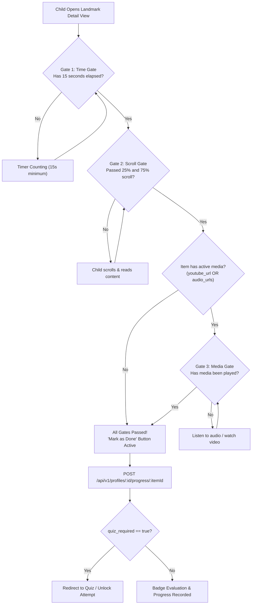

# Done-Tracking Gated Rules

In **Personal Learning Ground**, marking an educational landmark or lesson as "Done" (`profile_progress`) is not a casual single-click action. To guarantee genuine engagement and educational value, the system enforces a strict **Three-Gate Done Tracking Architecture**.

---

## 🚪 The Three Verification Gates

---

## 🔍 Detailed Gate Specifications

### 1. The 15-Second Time Gate
- **Purpose**: Prevents rapid clicking or "speedrunning" landmarks without viewing information.
- **Rule**: An internal active timer starts when the item detail view mounts. The child must remain on the page for at least **15 continuous seconds** before this gate opens.

### 2. The Scroll Gate (25% and 75% Checkpoints)
- **Purpose**: Ensures the child actually scrolls through the story, historical context, and fun facts.
- **Rule**: The scroll position of the reading container must cross both the **25%** and **75%** depth thresholds.
- **Short Content Exemption**: If an article is so short that no scrollbar exists (content height ≤ viewport height), both scroll checkpoints are automatically fulfilled once the time gate finishes.

### 3. The Media Gate (Dynamic Derivation)
- **Purpose**: Encourages listening to pronunciation guides, native language narrations, or documentary clips.
- **Rule**:
  > [!IMPORTANT]
  > The media gate is derived strictly from actual presence of `youtube_url` or non-empty `audio_urls` on the specific item record.
  > It is **never** inferred from the category-level `CategoryRegistry.hasMedia` flag.
- If the item possesses audio or video, the child must trigger playback before the gate unlocks. If no media exists on the item, Gate 3 is automatically satisfied.

---

## 📝 The `quiz_required` Constraint

- The `quiz_required` boolean indicates whether passing an assessment quiz is mandatory to claim the completion badge.
- **Authoritative Source**:
  - `quiz_required` is derived strictly from seed data (`quiz_questions`) during database seeding or catalog synchronization.
  - It is **never** manually set by client code or patched outside the validated seed path.
- When `quiz_required` is `true`:
  - Fulfilling the three gates marks the lesson as ready for quiz submission.
  - Final completion status (`done: true`) and associated badges are awarded only after scoring a passing grade on the quiz (`POST /api/v1/profiles/:id/quiz/items/:itemId/submit`).

---

## 🧭 Navigation & Cross References
- Functional Requirements: [[02-requirements/functional-requirements|Functional Requirements]]
- Catalog Entities: [[04-domain-entities/catalog-and-learning|Catalog and Educational Content Entities]]
- Progress Database Tables: [[05-database/tables-reference|Database Tables Reference (profile_progress, quiz_attempts)]]
- Quiz API Endpoints: [[06-api-reference/learning-and-quiz-routes|Learning and Quiz Routes]]
