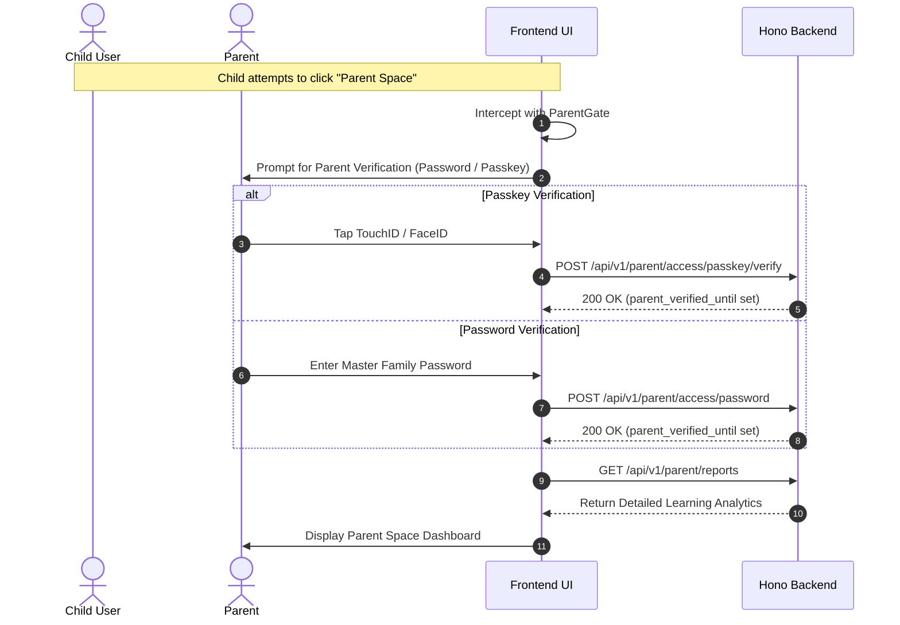

# Safety, Privacy and Parental Controls

The application is engineered from the ground up to protect children's online privacy and ensure parents retain complete supervision over content, contacts, and personal data.

---

## 🛡️ Child Safety Principles (COPPA Compliance)

1. **No Open Social Graph or Public Directory**:
   - There is no public user search or searchable directory of children.
   - Friend connections require explicit **Friend Codes** shared out-of-band between parents or families.
2. **Safe Pre-Scripted Communication Only**:
   - Children cannot send free-form text or direct messages to other players.
   - Social interaction in minigames (such as Town Baskets) uses curated, pre-approved greetings (e.g., "Hello friend!", "Thank you for the visit!", message IDs 0–9).
3. **No Third-Party Trackers or Behavioral Ads**:
   - Zero third-party analytics trackers, behavioral ad pixels, or commercial telemetry scripts are permitted in the client bundle.
4. **Isolated Media Storage**:
   - Child profile avatars are stored in private storage and served through authenticated application endpoints with strict ownership verification.

---

## 🔒 Parent Space Protection & Verification Gates

The **Parent Space** (`/parent/*`) is a secured sanctuary where parents manage family accounts, monitor child activity, configure custom lessons, and review achievements.

### Automatic Inactivity Locking
- Parent elevation is strictly session-bound and expires automatically after 15 minutes of inactivity (`parent_verified_until`).
- An explicit "Lock Parent Space" button (`POST /api/v1/parent/access/lock`) immediately wipes parent privileges from the session cookie and cache.

---

## 📚 Parental Lesson Control & Curated Overrides

Parents have the authority to tailor the educational experience to their family's values and syllabus:

1. **Disabling System Lessons (`family_disabled_lessons`)**:
   - If a parent considers specific content unsuitable or irrelevant for their children, they can toggle it off.
   - Disabled items vanish from the child's world map and explore lists immediately.
2. **Authoring Custom Lessons (`items` with `source_type = 'family'`)**:
   - Parents can author custom landmarks (e.g., family heritage locations, grandparents' hometowns, school field trips) complete with photos, bilingual stories, and custom quiz questions.
3. **Sharing Lessons Between Friends (`lesson_audiences`)**:
   - Parents can share authored lessons selectively with connected friend families or specific profiles.

---

## 🧭 Navigation & Cross References
- Functional Requirements: [[02-requirements/functional-requirements|Functional Requirements]]
- Security Architecture: [[01-architecture/security-and-auth|Security and Authentication Model]]
- Parent Space Routes: [[06-api-reference/parent-and-admin-routes|Parent and Admin Routes]]
- Domain Entities: [[04-domain-entities/core-entities|Core Identity Entities]]
