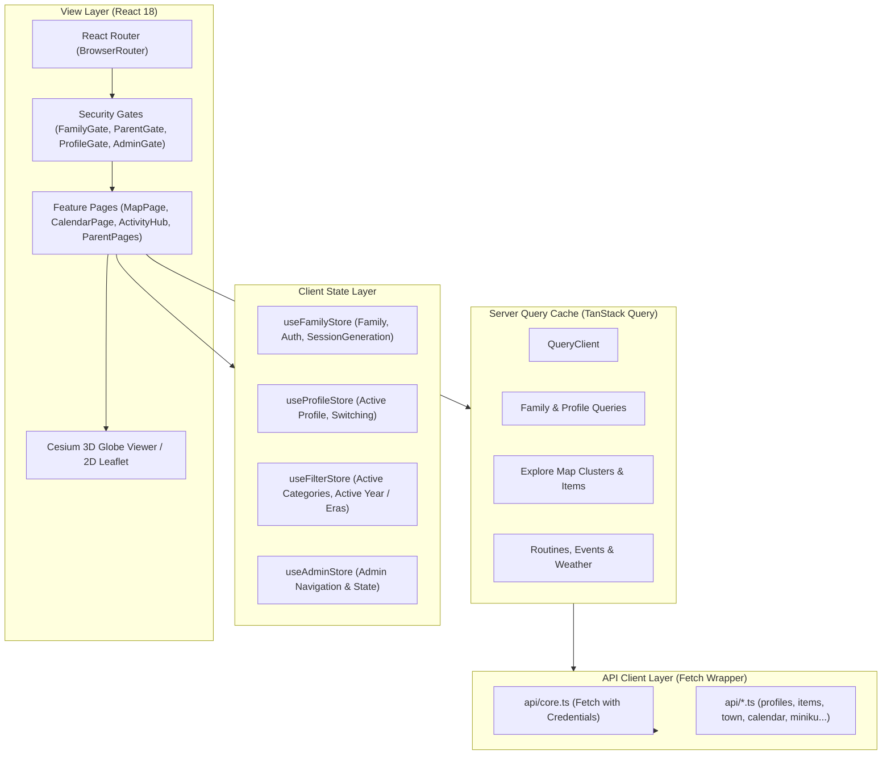

# Frontend Architecture & Client State

The frontend of **Personal Learning Ground** is structured as an interactive, highly responsive Single Page Application (SPA) designed to load swiftly and render rich 3D geospatial views alongside lightweight 2D minigames.

---

## 🏗️ Architectural Topology

---

## 🗃️ Client Stores (Zustand)

Client state that does not belong in the server cache is partitioned into specialized Zustand stores:

### 1. `useFamilyStore` (`frontend/src/stores/familyStore.ts`)
- **Responsibilities**: Holds currently authenticated family identity, login status, onboarding flags, and session generation counter.
- **Key Methods**:
  - `initSession()`: Reads active session state from `/api/v1/auth/session`.
  - `setAuthenticated(family)`: Updates family session.
  - `logout()`: Clears credentials and increments `sessionGeneration` to purge private query caches.

### 2. `useProfileStore` (`frontend/src/stores/profileStore.ts`)
- **Responsibilities**: Tracks which child profile is currently active in the UI.
- **Key Methods**:
  - `setActiveProfileId(profileId)`: Switches current child player.
  - `clearProfile()`: Resets active child profile, prompting the `ProfilePickerPage`.

### 3. `useFilterStore` (`frontend/src/stores/filterStore.ts`)
- **Responsibilities**: Coordinates map filters, categories, and historical era timelines.
- **Key Methods & Invariant**:
  > [!IMPORTANT]
  > `filterStore.clearEra()` clears **only** `activeYear`;
  > `filterStore.clearFilters()` clears **only** `activeCategories`.
  > Never substitute one for the other!

### 4. `useAdminStore` (`frontend/src/stores/adminStore.ts`)
- **Responsibilities**: Manages admin inspection state, active content edit drafts, and batch review filters.

---

## 🛡️ Route Gates & Navigation Protections

The routing pipeline (`frontend/src/App.tsx`) enforces hierarchical route gating:

1. **`FamilyGate`**:
   - Ensures an authenticated family session exists. If unauthenticated, renders `FamilyLoginPage`.
2. **`ProfileGate`**:
   - Ensures an active child profile is selected and verifies that the selected profile still belongs to the current server-owned profile list. If missing or invalid, renders `ProfilePickerPage`.
3. **`ParentGate`**:
   - Enforces parent verification (password/passkey) before revealing `ParentRoutes`. Clears parent cache upon access loss.
4. **`AdminGate`**:
   - Verifies the family account has `role === 'admin'`.

---

## 🌍 CesiumJS 3D Globe Integration

- **Lifecycle Management**:
  - Managed via `usePreparedMapView` and `preparedMapLifecycle.ts`.
  - Destroys WebGL contexts safely on component unmount to prevent GPU memory leaks.
- **Vite Plugin Integration**:
  - Pre-copies Cesium Workers, Widgets, and Assets into `dist/client/cesium/`.
  - Custom base URL configured via `window.CESIUM_BASE_URL = '/cesium/'`.

---

## 🧭 Navigation & Cross References
- Repository Layout: [[03-codebase-structure/repository-layout|Repository Layout]]
- Server Architecture: [[03-codebase-structure/server-architecture|Server Architecture]]
- Viewport Rules: [[02-requirements/viewport-and-ux|Minigame Viewport Requirements]]
- API Clients: [[06-api-reference/api-overview|API Reference]]
