# Server Architecture & Repository Pattern

The server tier of **Personal Learning Ground** is built using **Hono** on Node.js 20+ with TypeScript, structured around a clean **Layered Repository Pattern**.

---

## 🏛️ Layered Backend Architecture

```mermaid
flowchart TD
    Request["Incoming HTTP Request (/api/v1/...)"] --> HonoApp["Hono HTTP Engine (app.ts)"]

    subgraph Middlewares["Global Middlewares"]
        Trace["Request Tracing & ID (x-request-id)"]
        SecHeaders["Security Headers (CSP, Referrer, Frames)"]
        Cors["Origin Whitelist & Host Verification"]
        BodyLimit["Bounded Body Reader (Avatar vs Standard)"]
        RateLimit["AuthRateLimiter (Sliding Window)"]
        AuthMid["Authentication & Parent Access Guard"]
    end

    HonoApp --> Trace
    Trace --> SecHeaders
    SecHeaders --> Cors
    Cors --> BodyLimit
    BodyLimit --> RateLimit
    RateLimit --> AuthMid

    subgraph RouteHandlers["Domain Route Modules"]
        TownR["town-building/routes.ts"]
        QuizR["learning & daily-quiz"]
        CalR["calendar/routes.ts"]
        ExploreR["explore/http.ts"]
        MinigamesR["fishing, ufo, math-wall, infinidrill, miniku"]
        ParentR["parent-reports & parent lessons"]
        AdminR["admin content & achievement migration"]
    end

    AuthMid --> RouteHandlers

    subgraph ServiceLayer["Domain Business Services & Reducers"]
        TownSim["Town Grid, Lake & Raft Reducer"]
        QEngine["Shared Question Engine & Grading"]
        WeatherSvc["Open-Meteo Weather Service & Clock"]
        SnapBuilder["Explore Snapshot Materializer"]
    end

    RouteHandlers --> ServiceLayer

    subgraph Repositories["Repository Abstractions (contracts/db.ts)"]
        AppDB["AppDatabase Facade"]
        AuthRepo["AuthRepository"]
        ItemRepo["ItemRepository"]
        TownRepo["TownRepository"]
        CalRepo["CalendarRepository"]
        ProgRepo["ProgressRepository"]
    end

    ServiceLayer --> Repositories
    RouteHandlers --> Repositories

    subgraph DatabaseLayer["Data Access (db/)"]
        DrizzleORM["Drizzle ORM (schema.ts)"]
        NeonPool["Neon PostgreSQL Pooler"]
    end

    Repositories --> DrizzleORM
    DrizzleORM --> NeonPool
```

---

## 🧩 Architectural Contracts (`contracts/app.ts` & `contracts/db.ts`)

To ensure testability and prevent tight coupling between route handling and SQL execution, the backend decouples data access via the `AppDatabase` interface:

1. **`AppDatabase` Facade**:
   - Bundles all domain repositories (`auth`, `profiles`, `items`, `progress`, `quiz`, `flashcards`, `calendar`, `town`, `fishing`, `infinidrill`, `ufo`, `mathWall`, etc.).
   - Provides lifecycle hooks (`ping()`, `close()`).
2. **Deterministic Dependency Injection**:
   - The factory `createApp(deps: AppDependencies)` accepts `AppDatabase`, `AppConfig`, `Logger`, and optional mock clock or weather fetchers.
   - Allows Vitest integration test suites to execute against real test databases or mocked services with complete fidelity.

---

## 🛡️ Middlewares & Invariant Enforcement

Every incoming HTTP request traverses a standardized middleware pipeline in `server/src/app.ts`:

1. **`x-request-id`**:
   - Generates a UUID for every transaction, attaching it to request context `c.get("requestId")` and response headers.
2. **Security Headers & Host Enforcement**:
   - Prohibits framing (`DENY`), enforces strict content type nosniff, and drops disallowed Host/Origin headers with `421 Host Not Allowed` or `403 Origin Not Allowed`.
3. **Payload Size Guarding**:
   - Standard API requests are limited to `config.maxBodyBytes` (typically 1MB).
   - Avatar upload endpoints (`POST /api/v1/profiles/:id/avatar`) are granted an elevated bounded limit (`MAX_AVATAR_REQUEST_BYTES = 2.5MB`) while enforcing byte-stream chunk limits.
4. **Auth & Parent Access Guard**:
   - Intercepts protected paths (`/api/v1/parent/*`, `/api/v1/profiles/*`, `/api/v1/items/*`).
   - Resolves family from session token cookie.
   - For `/api/v1/parent/*`, verifies `session.parentVerifiedUntil >= now()`.

---

## 🧭 Navigation & Cross References
- Repository Layout: [[03-codebase-structure/repository-layout|Repository Layout]]
- Database Schema: [[05-database/schema-overview|Database Schema Overview]]
- Complete Tables Reference: [[05-database/tables-reference|Complete Database Tables Reference]]
- API Reference: [[06-api-reference/api-overview|API Reference Overview]]
