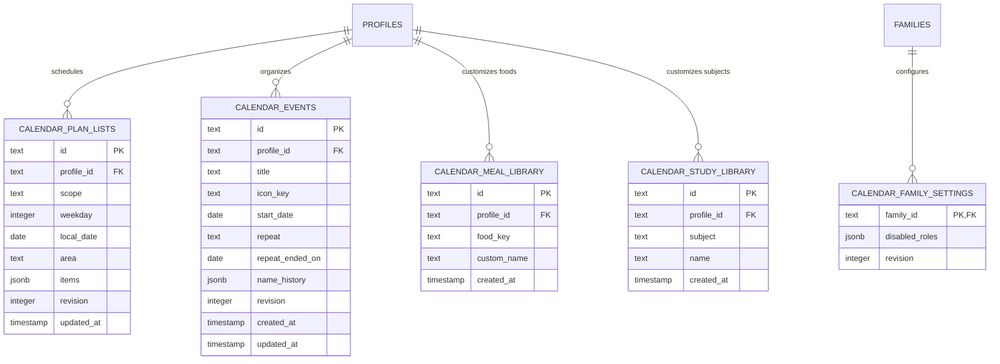

# Kid Calendar & Routine Models

The calendar domain structures a child's daily schedule, school study tasks, nutritious meal plans, and recurring medication reminders, enriched with local meteorological forecasts and lunar calendar dates.

---

## 📅 Entity Relationship Diagram

---

## 📋 Entity Specifications

### 1. `CalendarPlanList` (`calendar_plan_lists`)
Daily task checklists and meal plans. Supports dual-scope operation:
- **`scope`**:
  - `"template"`: A weekly recurring default template. Must define `weekday` (1–7, where 1=Monday).
  - `"date"`: A specific override for a single day. Must define `local_date` (YYYY-MM-DD).
- **`area`**: Functional schedule block:
  - `"study_morning"`, `"study_afternoon"`, `"study_extra"`
  - `"meal_breakfast"`, `"meal_lunch"`, `"meal_snack"`, `"meal_dinner"`
  - `"medicine"`
- **`items`**: JSON array of checklist items with completion checkboxes and custom notes.
- **`revision`**: Optimistic concurrency version counter.

### 2. `CalendarEvent` (`calendar_events`)
Milestones, holidays, birthdays, and appointments.
- **`title`**: Name of event.
- **`iconKey`**: Visual icon identifier (e.g., `"birthday"`, `"school"`, `"sports"`).
- **`startDate`**: Event occurrence date.
- **`repeat`**: Recurrence rule (`"none"`, `"weekly"`, `"monthly"`, `"yearly"`).
- **`repeatEndedOn`**: Optional termination date for repeating schedules.

### 3. `CalendarMealLibrary` (`calendar_meal_library`)
Quick-pick food items belonging to nutritious food groups (Grains, Vegetables, Fruits, Dairy, Protein).
- Allows custom personalized food entries alongside built-in recommendations.

### 4. `CalendarStudyLibrary` (`calendar_study_library`)
Personalized school subjects (e.g., Mathematics, Literature, Science, English, Music).

---

## 🌤️ Weather & Lunar Integration

- **Meteorological Forecasts**:
  - The calendar integrates with **Open-Meteo** using the child's home city coordinates (`native_city`, `native_country_code`).
  - Displays high/low temperatures, precipitation chances, and weather icons.
- **Lunar Calendar Engine**:
  - Built-in astronomical calculation converts solar dates to Lunar dates (e.g., Mid-Autumn Festival, Lunar New Year / Tết).

---

## 🧭 Navigation & Cross References
- Functional Requirements: [[02-requirements/functional-requirements|Functional Requirements]]
- Database Tables Reference: [[05-database/tables-reference|Complete Database Tables Reference]]
- Calendar API Routes: [[06-api-reference/calendar-routes|Calendar Routes]]
- Core Identity: [[04-domain-entities/core-entities|Core Identity Entities]]
