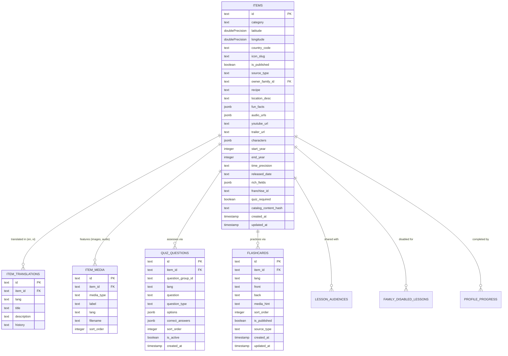

# Catalog & Educational Content Entities

The catalog domain models geographic locations, historical landmarks, cultural topics, and their associated educational assessments.

---

## 🗺️ Entity Relationship Diagram

---

## 📋 Entity Specifications

### 1. `Item` (`items`)
A physical landmark, historical event, animal habitat, culinary dish, or scientific discovery represented on the world map.
- **`id`**: Unique kebab-case slug (e.g., `"ha-long-bay"`, `"eiffel-tower"`).
- **`category`**: Category classification (`"history"`, `"nature"`, `"food"`, `"science"`, `"culture"`, etc.).
- **`latitude`** & **`longitude`**: Coordinate point on the 3D globe.
- **`countryCode`**: ISO 3166-1 alpha-2 country code.
- **`isPublished`**: Flag controlling catalog visibility.
- **`sourceType`**: `"system"` (built-in seed) or `"family"` (authored by a parent).
- **`ownerFamilyId`**: NULL for system items; references `families.id` for custom parent lessons.
- **`startYear`** & **`endYear`**: Temporal range for era-based timeline grouping.
- **`youtubeUrl`** & **`audioUrls`**: Media files triggering Gate 3 done-tracking.
- **`quizRequired`**: Mandatory flag derived from seed questions.
- **`catalogContentHash`**: SHA-256 hash of seed content for idempotent re-synchronization.

### 2. `ItemTranslation` (`item_translations`)
Bilingual content attached to an item.
- **`itemId`**: Foreign key to `items.id`.
- **`lang`**: Language code (`"en"` or `"vi"`).
- **`title`**: Localized landmark name.
- **`description`**: Engaging introductory summary.
- **`history`**: In-depth historical and cultural background story.

### 3. `ItemMedia` (`item_media`)
Photos, diagrams, and illustrations attached to an item.
- **`mediaType`**: `"image"`, `"diagram"`, `"audio"`.
- **`filename`**: CDN or local storage filename.
- **`sortOrder`**: Carousel presentation order.

### 4. `QuizQuestion` (`quiz_questions`)
Assessment question testing comprehension of an item.
- **`itemId`**: Foreign key to `items.id`.
- **`lang`**: `"en"` or `"vi"`.
- **`question`**: The question text.
- **`questionType`**: `"single_choice"`, `"multiple_choice"`, `"true_false"`.
- **`options`**: Array of string choices.
- **`correctAnswers`**: Zero-based array of correct answer indices.
- **`isActive`**: Allows soft-disabling questions without deletion.

### 5. `Flashcard` (`flashcards`)
Spaced repetition study card.
- **`front`**: Question / prompt side.
- **`back`**: Answer / explanation side.
- **`mediaHint`**: Optional pronunciation clip or visual clue.

---

## 🧭 Navigation & Cross References
- Done-Tracking Requirements: [[02-requirements/done-tracking|Done-Tracking Gated Rules]]
- Progress Entities: [[04-domain-entities/progress-and-achievements|Progress and Achievements Entities]]
- Database Tables Reference: [[05-database/tables-reference|Complete Database Tables Reference]]
- Catalog API Routes: [[06-api-reference/catalog-and-explore-routes|Catalog and Explore Routes]]
