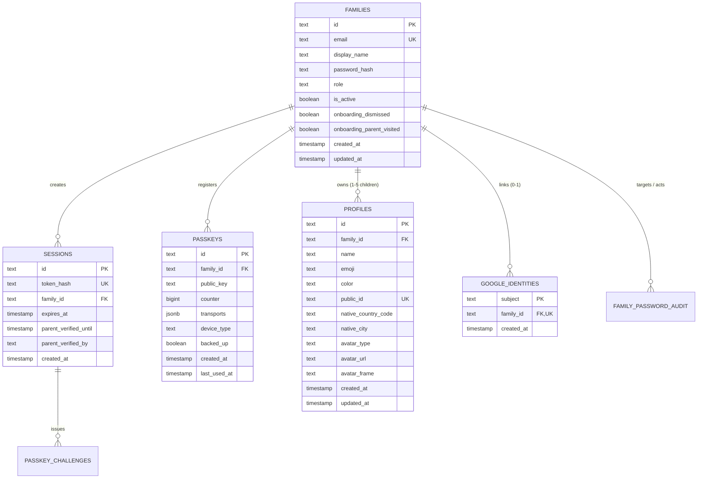

# Core Identity Entities

The identity domain establishes account ownership, child profiles, authentication credentials, and security assertions.

---

## 👥 Entity Relationship Diagram

---

## 📋 Entity Specifications

### 1. `Family` (`families`)
The top-level account representing a household or educational account.
- **`id`**: Unique text ID (UUID).
- **`email`**: Unique lowercase email address.
- **`displayName`**: Family name (e.g., "The Nguyen Family").
- **`passwordHash`**: Argon2id password hash or sentinel constant (`GOOGLE_ONLY_PASSWORD`).
- **`role`**: `"family"` (standard user) or `"admin"` (elevated platform administrator).
- **`isActive`**: Account activation flag.
- **`onboardingDismissed`** & **`onboardingParentVisited`**: Controls display of initial family setup tutorial.

### 2. `Profile` (`profiles`)
An individual child learner belonging to a family (up to 5 profiles per family).
- **`id`**: Internal profile UUID.
- **`familyId`**: Foreign key to `families.id` with cascade deletion.
- **`name`**: Child's name or nickname.
- **`emoji`**: Assigned emoji icon.
- **`color`**: Theme color hex / slug.
- **`publicId`**: Publicly shareable alphanumeric code (e.g., for friend requests).
- **`nativeCountryCode`** & **`nativeCity`**: Geographic origin for globe camera positioning and weather forecasting.
- **`avatarType`**: `"emoji"`, `"default"`, or `"custom"`.
- **`avatarUrl`**: Path or object storage key to custom avatar.
- **`avatarFrame`**: Optional cosmetic collectible frame (e.g., `"bronze"`, `"gold"`, `"ufo"`).

### 3. `Session` (`sessions`)
Active browser sessions authenticated via cookie.
- **`id`**: Session identifier.
- **`tokenHash`**: SHA-256 hash of the plain session token cookie.
- **`familyId`**: Foreign key to `families.id`.
- **`expiresAt`**: Session expiration timestamp.
- **`parentVerifiedUntil`**: Temporary elevation timestamp granting Parent Space access.
- **`parentVerifiedBy`**: Method used to elevate (`"password"`, `"passkey"`, or `"google"`).

### 4. `Passkey` (`passkeys`)
FIDO2 / WebAuthn public key credentials registered to a family.
- **`id`**: Base64URL credential ID.
- **`familyId`**: Foreign key to `families.id`.
- **`publicKey`**: Stored public key for signature verification.
- **`counter`**: Monotonic signature counter preventing replay attacks.
- **`transports`**: Supported transports (`["internal", "hybrid", "usb"]`).
- **`deviceType`**: `"singleDevice"` or `"multiDevice"`.
- **`backedUp`**: Boolean indicating sync/cloud backup status.

### 5. `GoogleIdentity` (`google_identities`)
Maps an external Google OAuth subject ID to a family account.
- **`subject`**: Unique Google sub claim.
- **`familyId`**: Unique foreign key to `families.id` (1:1 relationship).

---

## 🧭 Navigation & Cross References
- Security Model: [[01-architecture/security-and-auth|Security and Authentication Model]]
- Database Tables Reference: [[05-database/tables-reference|Complete Database Tables Reference]]
- Auth API Endpoints: [[06-api-reference/auth-and-profile-routes|Auth and Profile Routes]]
- Catalog Entities: [[04-domain-entities/catalog-and-learning|Catalog and Educational Content Entities]]
