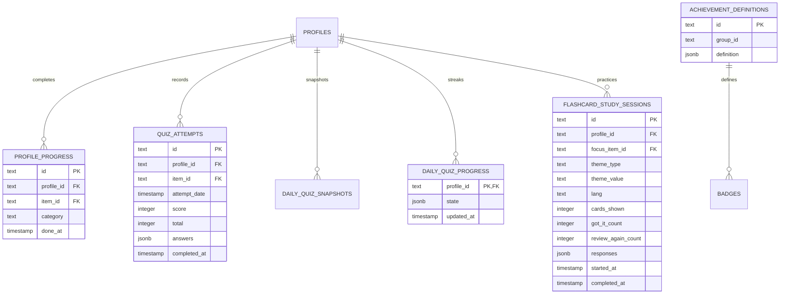

# Progress & Achievements Entities

The progression domain records every verified child accomplishment, quiz attempt, flashcard session, and earned collectible badge.

---

## 🏅 Entity Relationship Diagram

---

## 📋 Entity Specifications

### 1. `ProfileProgress` (`profile_progress`)
Records a child successfully fulfilling the requirements for an educational landmark.
- **`profileId`**: Foreign key to `profiles.id`.
- **`itemId`**: Foreign key to `items.id`.
- **`category`**: Category slug for quick aggregate reporting.
- **`doneAt`**: UTC timestamp when the landmark was completed.
- **Unique Constraint**: `(profileId, itemId)` ensures a landmark is marked done at most once per child.

### 2. `QuizAttempt` (`quiz_attempts`)
Records every graded quiz submission.
- **`profileId`**: Foreign key to `profiles.id`.
- **`itemId`**: Foreign key to `items.id`.
- **`score`**: Number of correct questions.
- **`total`**: Total number of questions in the quiz.
- **`answers`**: JSON record of selected options.
- **`completedAt`**: Submission timestamp.

### 3. `AchievementDefinition` (`achievement_definitions`)
Authoritative catalog of all server-verified collectible badges across the platform.
- **`id`**: Unique achievement slug (e.g., `"infinidrill-core-champion"`).
- **`groupId`**: Logical grouping (e.g., `"infinidrill-earth"`, `"shoo-shoo-ufo"`, `"waddle-wall"`, `"town-building"`).
- **`definition`**: JSONB containing:
  - `name`: Display title.
  - `description`: Unlock requirement criteria.
  - `badge`: Image URL or spritesheet path.
  - `badgeIndex`, `badgeColumns`, `badgeRows`: Coordinates for sprite atlas extraction.
  - `difficulty`: `"easy"`, `"medium"`, `"hard"`, or `"legendary"`.
  - `metric`: Server-verified metric tracking the unlock condition.
  - `target`: Quantitative target required.

---

## 🎨 Universal Badge Art Language

In accordance with repository guidelines:
- All minigame badge artwork follows the storybook collectible medallion style defined in `UNIVERSAL_BADGE_ART_PROMPT.md`.
- Medallions are text-free; badge name, difficulty, and unlock requirements are presented as structured text in the UI.

---

## 🧭 Navigation & Cross References
- Done Tracking Rules: [[02-requirements/done-tracking|Done-Tracking Gated Rules]]
- Minigames Overview: [[07-minigames/minigames-overview|Minigames Overview]]
- Database Tables Reference: [[05-database/tables-reference|Complete Database Tables Reference]]
- Parent Reports API: [[06-api-reference/parent-and-admin-routes|Parent and Admin Routes]]
