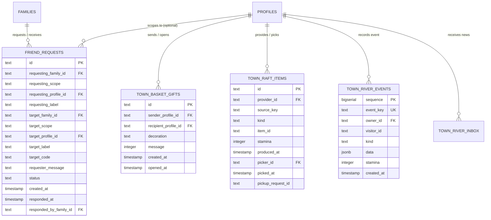

# Social & Community Interaction Entities

The social domain models positive, safe interactions between verified friends and family circles without public messaging risks.

---

## 🤝 Entity Relationship Diagram

---

## 📋 Entity Specifications

### 1. `FriendRequest` (`friend_requests`)
A formal connection request between two accounts.
- **`requestingScope`** & **`targetScope`**: `"family"` (connects household accounts) or `"profile"` (connects specific child profiles).
- **`targetCode`**: The private alphanumeric code supplied out-of-band by the recipient.
- **`status`**: `"pending"`, `"accepted"`, `"rejected"`, or `"cancelled"`.
- **`crossFamily Check`**: Ensures families cannot send friend requests to themselves.

### 2. `TownBasketGift` (`town_basket_gifts`)
Surprise gift baskets sent between connected friends' town islands.
- **`decoration`**: Cosmetic basket topper (`"flowers"`, `"balloons"`, `"gnome"`).
- **`message`**: Integer ID (0–9) referencing pre-scripted, child-safe greeting cards.
- **`openedAt`**: Recorded when the recipient discovers the basket on their island.

### 3. `TownRaftItem` (`town_raft_items`)
Shared trading rafts floating between friends' islands down the river.
- **`kind`**: `"fish"`, `"vegetable"`, or `"egg"`.
- **`stamina`**: Energy boost granted upon pickup (1–10).
- **`pickupRequestId`**: Idempotency token preventing double-collection.

### 4. `TownRiverEvent` (`town_river_events`) & `TownRiverInbox` (`town_river_inbox`)
An append-only timeline of visitors, gifted baskets, and raft deliveries seen in the child's River Log.

---

## 🧭 Navigation & Cross References
- Safety and Privacy: [[02-requirements/safety-and-privacy|Safety and Privacy Requirements]]
- Town Island Simulation: [[07-minigames/town-building|Town Building Minigame]]
- Database Tables Reference: [[05-database/tables-reference|Complete Database Tables Reference]]
- Social API Routes: [[06-api-reference/auth-and-profile-routes|Auth and Profile Routes]]
