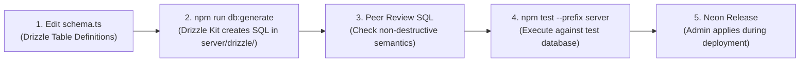

# Database Migrations Workflow

The database migration strategy in **Personal Learning Ground** combines **Drizzle Kit** schema management with curated Neon SQL transition scripts to guarantee zero-downtime, non-destructive database evolution.

---

## 🛠️ Drizzle Kit Migration Lifecycle

All schema definitions originate in `server/src/db/schema.ts`. When changing tables or columns:



### Key Migration Commands
```bash
# Generate SQL migration files from schema.ts changes
npm run db:generate --prefix server

# Apply pending migrations to the active database
npm run db:migrate --prefix server

# Check database connection and schema health
npm run db:check --prefix server
```

---

## 🔒 Safe Migration Guidelines & Production Invariants

> [!CAUTION]
> **Production Safety Invariants**:
> 1. Never run migrations or seed commands against production data from a local feature branch.
> 2. Never drop columns or truncate tables without an explicit deprecation grace period.
> 3. New columns must be `nullable` or include a safe `DEFAULT` value to prevent migration locks on populated tables.
> 4. Unique constraints on existing tables must use `CONCURRENTLY` or partial indices where applicable.

---

## 🏅 The Single Admin Migration Button

In accordance with repository guidelines:
- An authenticated, admin-only API (`POST /api/v1/admin/achievements/migrate`) handles achievement catalog synchronization.
- It compares server-reviewed definitions against `achievement_definitions`, installing or updating only modified groups.
- Repeated runs are **strictly idempotent** and preserve earned badges and child progress.

---

## 🧭 Navigation & Cross References
- Complete Tables Reference: [[05-database/tables-reference|Complete Database Tables Reference]]
- Schema Overview: [[05-database/schema-overview|Database Schema Overview and ERD]]
- Seed Data Management: [[05-database/seed-data|Seed Data and Content Refresh]]
- Release and Deployment: [[08-development-and-ops/release-and-deployment|Deployment and Operations]]
