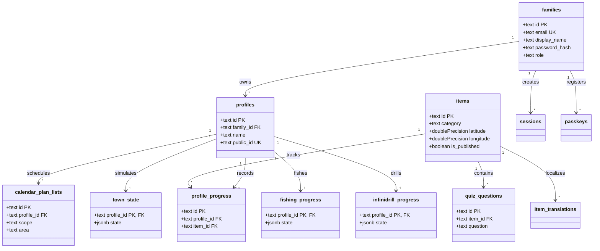

# Database Schema Overview & ERD

The **Personal Learning Ground** persistence tier runs on **Neon PostgreSQL 16+** using **Drizzle ORM**. The database is normalized around core relational boundaries while utilizing indexed `jsonb` columns for game state reducers, complex layouts, and localized question options.

---

## 🗄️ Database Architecture Highlights

1. **Strict Relational Integrity**:
   - Foreign key constraints with `ON DELETE CASCADE` ensure that removing a family or child profile cleanly removes all associated quiz attempts, minigame progress, calendar lists, and social baskets without orphaned records.
2. **Robust Check Constraints**:
   - Scores, totals, percentages, coordinates, and status enums are enforced at the database level using SQL check constraints.
3. **Optimized Multi-Column & Partial Indexes**:
   - Unique partial indexes enforce pending friend request uniqueness and template calendar uniqueness while keeping index size minimal.
4. **Authoritative Materialized Snapshots**:
   - Heavy explore tree hierarchies are stored in `explore_snapshots` as pre-computed blobs, decoupled from transactional user tables.

---

## 📊 Comprehensive Schema Entity Map

---

## 🧭 Navigation & Cross References
- Complete Tables Reference: [[05-database/tables-reference|Complete Database Tables Reference]]
- Migration Workflow: [[05-database/migrations|Database Migrations]]
- Seed Data Management: [[05-database/seed-data|Seed Data and Content Refresh]]
- Core Entities: [[04-domain-entities/core-entities|Core Domain Entities]]
