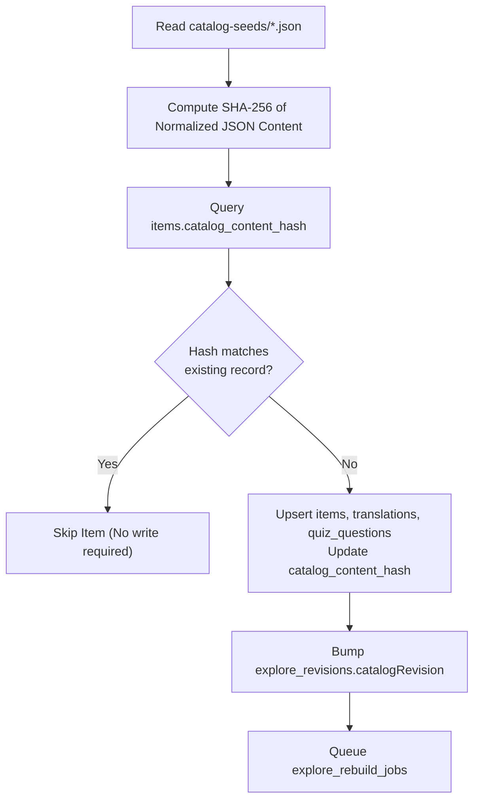

# Seed Data & Content Refresh Pipeline

The geographic landmarks, historical articles, quiz questions, and bilingual descriptions forming the educational core of **Personal Learning Ground** originate as reviewed JSON seed files.

---

## 📂 Catalog Seeds Location

Seed files reside in:
`frontend/data/catalog-seeds/`

These files contain:
- Landmark coordinate metadata (`latitude`, `longitude`, `countryCode`).
- Era and category classifications.
- Localized English and Vietnamese text (`item_translations`).
- Quiz questions with validated correct answers (`quiz_questions`).
- Flashcard prompts and explanations (`flashcards`).

---

## 🔄 Content Hash Versioning (`catalog_content_hash`)

To avoid redundant database writes and excessive Neon CPU consumption during seed updates:



---

## ⚙️ Refresh & Sync Commands

```bash
# Seed initial admin account and default catalog
npm run db:seed --prefix server

# Trigger catalog refresh from seed files
npm run catalog:refresh --prefix server
```

The server also exposes an authenticated admin endpoint (`POST /api/v1/admin/items/refresh`) with a background worker manager (`CatalogRefreshJobManager`) providing progress reporting via `GET /api/v1/admin/items/refresh/status`.

---

## 🧭 Navigation & Cross References
- Complete Tables Reference: [[05-database/tables-reference|Complete Database Tables Reference]]
- Explore Snapshots: [[01-architecture/caching-and-performance|Caching and Performance Architecture]]
- Admin Ingestion API: [[06-api-reference/parent-and-admin-routes|Parent and Admin Routes]]
- Local UAT Launcher: [[08-development-and-ops/local-development|Local Development and UAT]]
