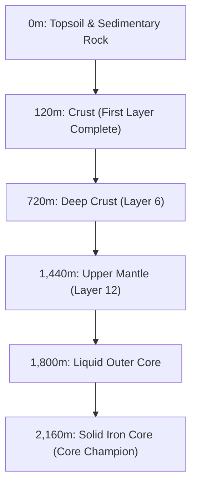

# InfiniDrill · Earth Expedition

**InfiniDrill** (`/infinidrill`) is an underground geological expedition game where children pilot a high-tech drill toward the Earth's core by solving mental and visual math problems.

---

## 🌍 The 18 Earth Layers & Depth Progression

The expedition begins at the surface (0 metres) and descends through 18 scientifically sequenced Earth layers down to the planetary core (2,160 metres):

---

## 🧮 Mathematical Drill Mechanics

1. **Main Layer Math**:
   - Each drill descent requires answering mental arithmetic or visual geometry questions (fractions, sequences, number bonds).
   - Fast, correct answers prevent drill overheating and maintain fuel momentum.
2. **Cave Discoveries & Bonus Puzzles**:
   - Scoring 5 consecutive first-try correct answers in under 15 seconds uncovers hidden subterranean caves.
   - Caves contain rare bonus mineral deposits protected by high-difficulty challenge puzzles.
3. **Drill Workshop Upgrades**:
   - Minerals mined during the descent (quartz, copper, titanium, obsidian, diamond) are spent in the workshop on 20 distinct drill upgrades:
     - Reinforced Drill Bits (faster rock penetration).
     - Cryo Coolers (heat resistance in magma layers).
     - Mineral Cargo Bays (increased haul capacity).
     - Geothermal Engines (fuel efficiency).

---

## 🏅 InfiniDrill Achievements

Part of the `infinidrill-earth` achievement group:
- **First Dig**: Answer 1st main math puzzle correctly.
- **Below the Surface**: Reach 120 metres (Layer 1).
- **Deep Digger**: Reach 720 metres (Layer 6).
- **Mantle Explorer**: Reach 1,440 metres (Layer 12).
- **Cave Finder**: Open a hidden cave with 5 speed-streak answers.
- **Workshop Master**: Collect all 20 drill upgrade components.
- **Core Champion (Legendary)**: Complete all 18 layers and reach 2,160 metres in a single expedition.

---

## 🧭 Navigation & Cross References
- Minigames Overview: [[07-minigames/minigames-overview|Minigames Overview]]
- InfiniDrill Tables: [[05-database/tables-reference|Database Tables Reference (infinidrill_progress)]]
- InfiniDrill API: [[06-api-reference/minigame-routes|Minigame API Routes]]
