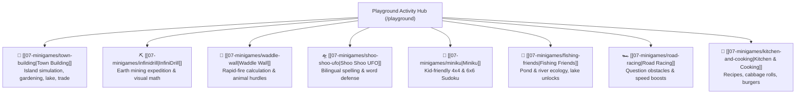

# Minigames & Educational Activities Overview

Minigames in **Personal Learning Ground** provide interactive, gamified reinforcement of concepts explored across the world map. Every minigame is architected to run smoothly within strict viewport boundaries, strictly verify all progress on the server, and award collectible illustrated badges.

---

## 🎮 The Minigame Suite

---

## 📜 Core Architectural Mandates for All Minigames

1. **Implementation `AGENTS.md`**:
   - Every minigame implementation directory must contain an `AGENTS.md` defining its numbered intake questions, badge rules, and viewport constraints.
2. **Strict Viewport Containment**:
   - Must fit within laptop screens and iPad landscape screens (1366×768, 1024×768, 1180×820) with **zero vertical or horizontal scrolling**.
3. **Named Achievement Groups & Medallions**:
   - Every minigame must possess one or more achievements in a named group registered in `server/src/achievement-catalog.ts`.
   - Artwork must match the shared collectible medallion prompt in `UNIVERSAL_BADGE_ART_PROMPT.md`.
4. **Server-Verified Progression**:
   - Scores, moves, answers, and completion states are validated authoritatively on the server. Client-reported results are never trusted blindly.
5. **Parent and Admin Reporting**:
   - Every minigame's achievement group must be projected into the child profile reports in **both Parent Space and Admin Space**.
6. **Resource Collection Feedback**:
   - Awarded resources (wood, stone, sand) display centered `+N` animations flying to the visible `TownRewardBar` or inventory icon.

---

## 🧭 Navigation & Cross References
- Viewport Requirements: [[02-requirements/viewport-and-ux|Minigame Viewport Requirements]]
- Universal Badge Prompt: `frontend/public/minigames/achievements/UNIVERSAL_BADGE_ART_PROMPT.md`
- Achievement Catalog Schema: [[05-database/tables-reference|Database Tables Reference (achievement_definitions)]]
- Playground Routing: [[03-codebase-structure/frontend-architecture|Frontend Architecture]]
