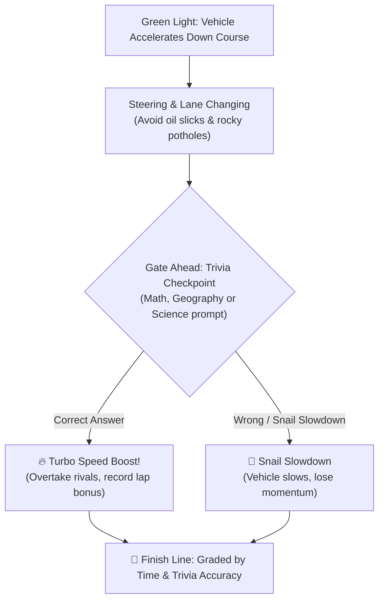

# Road Racing · Trivia Speed Sprint

**Road Racing** (`/road-racing`) combines arcade top-down obstacle steering with educational checkpoint trivia, challenging learners to dodge road hazards and answer rapid questions to trigger turbo boosts.

---

## 🏎️ Course Mechanics & Hazards

---

## 🐌 Snail Slowdown Mechanics

- If the player hits a snail hazard or misses a trivia question, the vehicle experiences a momentary "Snail Slowdown" penalty.
- Overcoming slow penalties without forfeiting awards resilience badges (`slow-and-steady`, `snail-survivor`).

---

## 🏅 Road Racing Achievements

From the `road-racing` achievement group:
- **First Lap**: Complete 1st racing course.
- **Speed Scholar**: Pass all trivia checkpoints with 100% accuracy.
- **Snail Survivor**: Recover from 3 snail hazards and still achieve 1st place.
- **Grand Prix Champion**: Win gold on all world highway courses.

---

## 🧭 Navigation & Cross References
- Minigames Overview: [[07-minigames/minigames-overview|Minigames Overview]]
- Road Racing Tables: [[05-database/tables-reference|Database Tables Reference (road_racing_progress)]]
- Road Racing API Routes: [[06-api-reference/minigame-routes|Minigame API Routes]]
