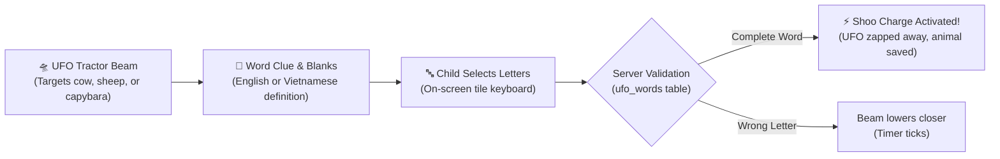

# Shoo Shoo UFO · Vocabulary Defense

**Shoo Shoo UFO** (`/shoo-shoo-ufo`) is an educational spelling and vocabulary defense game where children defend farm animals from alien tractor beams by deciphering letter tiles and solving bilingual word puzzles.

---

## 🛸 Game Overview & Core Loop

---

## 🇻🇳 Bilingual Dictionaries & Tone Accents

*Shoo Shoo UFO* is fully bilingual, evaluating words across English and Vietnamese dictionaries:
- **English Vocabulary**: 2 to 18 uppercase letters (`^[A-Z]{2,18}$`).
- **Vietnamese Vocabulary**: Words with diacritical marks and tones (sắc, huyền, hỏi, ngã, nặng) matching `VIETNAMESE_CHARACTERS` (`^[A-ZÀÁ...]+( [A-ZÀÁ...]+)*$`).
- **Difficulty Tiers**:
  - `easy`: 3–5 letters; everyday objects, animals, and family members.
  - `medium`: 6–8 letters; nature, school, and geography terms.
  - `hard`: Compound words and complex cultural expressions.

---

## 🐾 Farm Animal Companions

Players protect four beloved animal friends:
1. **Dairy Cow**: Loved for milk & letters.
2. **Highland Cow**: Fluffy scholar from mountain pastures.
3. **Woolly Sheep**: Playful wordsmith.
4. **Capybara**: Calm, clever friend of all creatures.

Solving words alongside specific animals unlocks specialized companion badges (`friends.cow`, `friends.highland`, `friends.sheep`, `friends.capybara`, and `friends.each`).

---

## 🧭 Navigation & Cross References
- Minigames Overview: [[07-minigames/minigames-overview|Minigames Overview]]
- UFO Database Tables: [[05-database/tables-reference|Database Tables Reference (ufo_words, ufo_progress)]]
- UFO API Routes: [[06-api-reference/minigame-routes|Minigame API Routes]]
