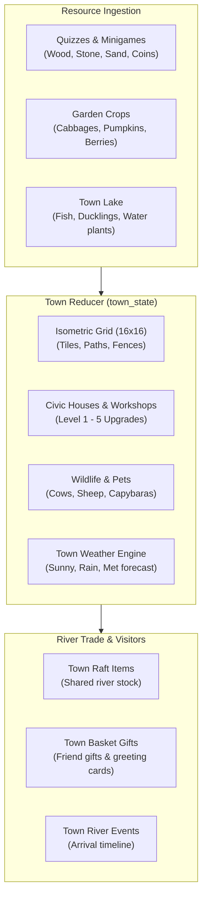

# Town Building & Island Simulation

**Town Building** (`/town-building`) is a persistent island-building simulation where children utilize materials earned across quizzes and minigames to cultivate gardens, raise poultry, build civic structures, and welcome visiting friends.

---

## 🏝️ Island Mechanics & Subsystems

---

## 🌾 Gardening & Wildlife Ecology

- **Crop Growth Cycles**: Crops progress through seeded, sprouting, and ready-to-harvest stages influenced by town weather and watering routines (`gardenSimulation.ts`).
- **Town Lake & Aquatic Life**:
  - The Town Lake map features water depth layers, swimming ducks, and fish schools.
  - Feeding waterfowl unlocks eggs and feathers used in crafting.
- **Wildlife Interactions**:
  - Animals (dairy cows, Highland cattle, sheep, and friendly capybaras) wander the island with realistic pasture habits (`animalHabits.ts`).
  - Caring for animals increases their friendship level and produces milk, wool, and comfort.

---

## 🎃 Seasonal & Timed Events (ADR-008)

Town islands experience dynamic seasonal events:
- **Halloween Event**:
  - Spooky ghostly skies, wandering spirit critters (`ghostMotion.ts`), and pumpkin lantern crafting (`halloweenCalendar.ts`).
  - Unlocks exclusive Halloween badge medallions.
- **Women's Day Event**:
  - Special flower stalls and greeting missions celebrating mothers, grandmothers, and female role models.

---

## 🛶 Social River Trade & Friend Baskets

- **Friend Baskets (`town_basket_gifts`)**: Children leave decorated baskets with pre-scripted messages on friends' islands.
- **Shared Rafts (`town_raft_items`)**: Rafts float down the shared river loaded with produce and fresh catches. Friends take what they need to recharge minigame stamina.

---

## 🧭 Navigation & Cross References
- Minigames Overview: [[07-minigames/minigames-overview|Minigames Overview]]
- Town Database Tables: [[05-database/tables-reference|Database Tables Reference (town_state, town_raft_items)]]
- Town API Endpoints: [[06-api-reference/minigame-routes|Minigame API Routes]]
- ADR-008: [[01-architecture/adrs-and-decisions|Architecture Decision Records]]
