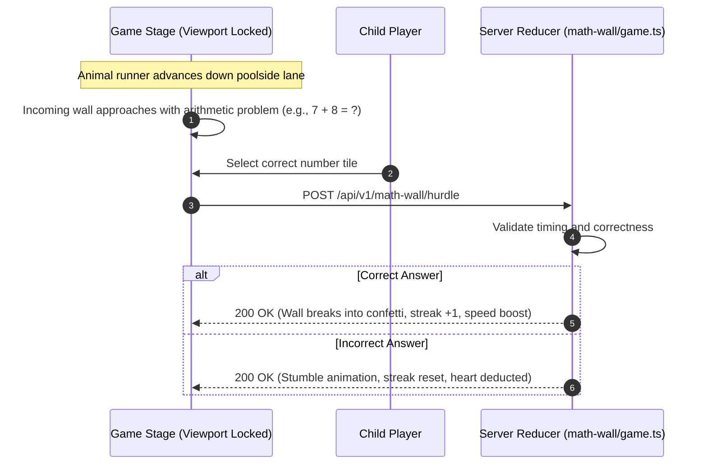

# Waddle Wall (Math Quiz Wall)

**Waddle Wall** (`/waddle-wall`) is a high-speed arcade arithmetic runner where child players guide an animal companion past advancing puzzle walls by rapid-fire mental calculation.

---

## 🏃 Gameplay Mechanics & Wall Breaches

---

## ⚡ Streak System & Difficulty Scaling

- **Heart Parade**:
  - Consecutive correct answers build a multiplier streak, unlocking celebratory audio cues and star trails.
- **Difficulty Tiers**:
  - **Sunny Thinker (Easy - Medium)**: Single-digit addition, subtraction, and basic pattern completion.
  - **Orange Explorer (Hard)**: Multi-step arithmetic, multiplication tables, and reverse equations (e.g., `? × 6 = 42`).
  - **Math Scientist (Legendary)**: Consecutive hard walls passed under strict time pressure.

---

## 🏅 Waddle Wall Achievements

From the `waddle-wall` achievement group:
- **First Waddle**: Pass 1st wall.
- **Wall Wanderer**: Pass 10 walls.
- **Poolside Pro**: Pass 50 walls.
- **Heart Parade**: Pass 5 walls in a row without a stumble.
- **Math Scientist**: Pass 10 hard walls.

---

## 🧭 Navigation & Cross References
- Minigames Overview: [[07-minigames/minigames-overview|Minigames Overview]]
- Waddle Wall Tables: [[05-database/tables-reference|Database Tables Reference (math_wall_progress)]]
- Waddle Wall API: [[06-api-reference/minigame-routes|Minigame API Routes]]
- ADR-004: [[01-architecture/adrs-and-decisions|Architecture Decision Records]]
