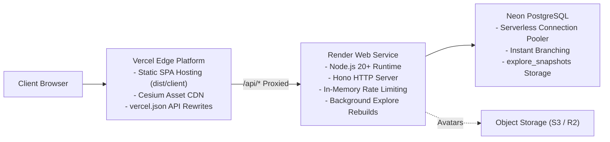

# Deployment & Operations Guide

This guide details the hosting, deployment, and operational procedures for **Personal Learning Ground** on **Vercel**, **Render**, and **Neon**.

---

## 🚀 Production Hosting Architecture

---

## 🌐 Environment Variables Configuration

Sensitive credentials and environment configuration are maintained directly within platform dashboard settings, **never** in source control:

### Render API Environment Variables

- `DATABASE_URL`: Neon pooled PostgreSQL connection string (`postgres://...`).
- `PORT`: Service port (default `10000`).
- `ALLOWED_ORIGINS`: Comma-separated list of whitelisted frontend origins.
- `ALLOWED_HOSTS`: Comma-separated list of allowed host headers.
- `AUTH_TRUSTED_PROXY_CIDRS`: Trusted CIDR blocks (for client IP resolution behind Render proxy).
- `AUTH_RATE_LIMIT_MAX`: Maximum auth attempts per rate-limiting window (e.g., `10`).
- `AUTH_RATE_LIMIT_WINDOW_SECONDS`: Sliding window duration (e.g., `60`).
- `OPEN_METEO_BASE_URL`: Meteorological forecast endpoint.
- `GOOGLE_CLIENT_ID` & `GOOGLE_CLIENT_SECRET`: Google OAuth credentials for family login.

### Vercel Environment Variables

- Frontend builds rely primarily on relative paths (`/api/*`), configured via `vercel.json` rewrites.

---

## 🔒 Release Safety Checklist

> [!caution]
> **Safety Invariants**:
>
> 1. Do not create or modify cloud resources (Vercel, Render, Neon, S3) from a feature branch.
> 2. Do not run destructive database commands or arbitrary seed scripts against production databases.
> 3. Production secrets must remain in platform key vaults, never checked into git.
> 4. Do not merge feature branches to `main` until explicitly confirmed by the team.

---

## 🧭 Navigation & Cross References

- System Overview: [[01-architecture/overview|System Architecture Overview]]
- Security Model: [[01-architecture/security-and-auth|Security and Authentication Model]]
- Database Migrations: [[05-database/migrations|Database Migrations]]
- Wiki Index: [[index|Personal Learning Ground Wiki Home]]
