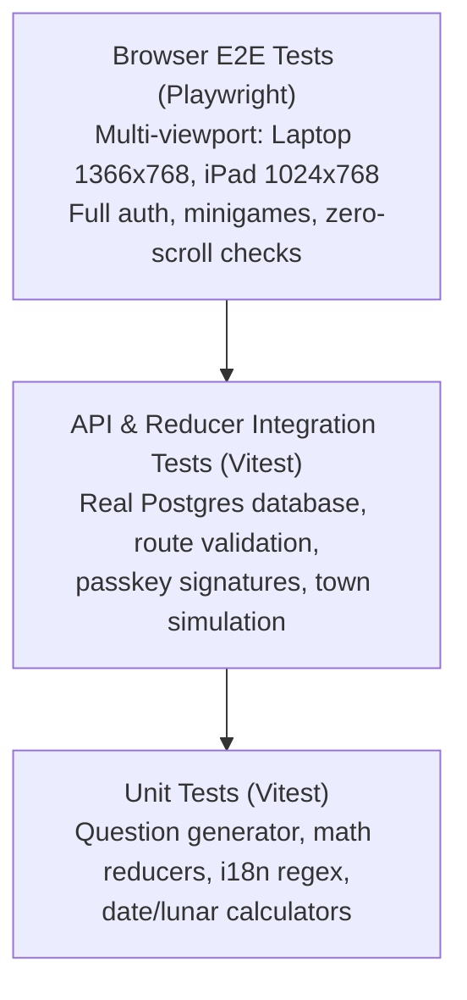

# Testing & Verification Strategy

The test suite of **Personal Learning Ground** guarantees stability across database migrations, API contracts, 3D globe rendering, and minigame gameplay logic.

---

## 🧪 Testing Pyramid



---

## 🚦 Standard Quality Gates

Before pushing code or preparing a release, execute the standard verification gates:

```bash
# 1. Frontend Gates
npm test --prefix frontend
npm run typecheck:hosting --prefix frontend
npm run build --prefix frontend

# 2. Server Gates
npm test --prefix server
npm run typecheck --prefix server
npm run build --prefix server
```

---

## 🛡️ Git Hooks & Artifacts Prevention

The repository enforces a strict rule: **Generated test artifacts never enter Git history.**

- **Install Hooks**: Run `scripts/install-git-hooks.sh` once per checkout clone.
- **Hook Script**: `scripts/check-generated-artifacts.sh` executes on `pre-commit` and `pre-push`.
- **Refused Paths**:
  - `test-results/`, `playwright-report/`, `coverage/`, `output/`.
  - Screenshots (`*.png`, `*.jpg`), video recordings (`*.webm`), CPU profiles (`*.cpuprofile`), and heap snapshots.
- **Remedy**: If artifacts are accidentally tracked, unstage them using:
  ```bash
  git rm -r --cached <path>
  ```
  Never bypass the hook with `--no-verify`.

---

## 🧭 Navigation & Cross References
- Local Development: [[08-development-and-ops/local-development|Local Development and UAT]]
- Release & Deployment: [[08-development-and-ops/release-and-deployment|Deployment and Operations]]
- Viewport Requirements: [[02-requirements/viewport-and-ux|Minigame Viewport Requirements]]
