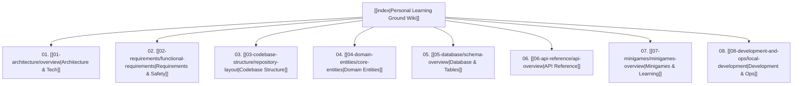

# Personal Learning Ground Wiki

Welcome to the **Personal Learning Ground** documentation vault, structured for viewing and navigation in **HelixNotes**, Obsidian, or standard Markdown viewers.

This repository powers a bilingual (English / Vietnamese) educational world-map, calendar, and minigame platform designed for families, children, parents, and educators.

---

## 🗺️ Map of Content

---

## 📚 Section Breakdown

### 1. [[01-architecture/overview|System Architecture & Decisions]]
- [[01-architecture/overview|System Architecture Overview]]: Vercel + Render + Neon PostgreSQL architecture.
- [[01-architecture/security-and-auth|Security & Authentication]]: Session cookies, Argon2id, WebAuthn Passkeys, Google OAuth, and Parent Lock.
- [[01-architecture/adrs-and-decisions|Architecture Decision Records (ADRs)]]: Decisions ADR-001 through ADR-008.
- [[01-architecture/caching-and-performance|Caching & Performance]]: Explore snapshots, spatial bounds, Cesium assets, and rate limits.

### 2. [[02-requirements/functional-requirements|Requirements & UX Policies]]
- [[02-requirements/functional-requirements|Functional Requirements]]: Core learning missions, bilingual support (`en` / `vi`), child & family scopes.
- [[02-requirements/safety-and-privacy|Safety, Privacy & Parental Controls]]: Safe boundaries, verification gates, and COPPA principles.
- [[02-requirements/viewport-and-ux|Minigame Viewport & UX Standards]]: Zero-scroll rules for laptops & iPad landscape (1366×768, 1024×768, 1180×820).
- [[02-requirements/done-tracking|Done-Tracking Gated Rules]]: 15s timer, 25%/75% scroll checkpoints, and active media playback gate.

### 3. [[03-codebase-structure/repository-layout|Codebase Structure]]
- [[03-codebase-structure/repository-layout|Repository Layout]]: Monorepo structure (`frontend/`, `server/`, `docs/`, `scripts/`).
- [[03-codebase-structure/frontend-architecture|Frontend Architecture]]: React 18, Vite, Zustand, TanStack Query, Cesium 3D globe, and Tailwind.
- [[03-codebase-structure/server-architecture|Server Architecture]]: Node.js / TypeScript Hono HTTP framework, Drizzle ORM, and layered repository design.
- [[03-codebase-structure/shared-conventions|Shared Conventions & Types]]: Strict TypeScript (`noUncheckedIndexedAccess`), i18n, and styling.

### 4. [[04-domain-entities/core-entities|Domain Entities & Models]]
- [[04-domain-entities/core-entities|Core Identity Entities]]: `Family`, `Session`, `Profile`, `Passkey`, and `GoogleIdentity`.
- [[04-domain-entities/catalog-and-learning|Catalog & Educational Content]]: `Item`, `ItemTranslation`, `ItemMedia`, `QuizQuestion`, and `Flashcard`.
- [[04-domain-entities/progress-and-achievements|Progress & Achievements]]: `ProfileProgress`, `QuizAttempt`, `DailyQuizSnapshot`, and `AchievementDefinition`.
- [[04-domain-entities/calendar-and-routines|Kid Calendar & Routine Models]]: `CalendarPlanList`, `CalendarEvent`, `CalendarMealLibrary`, and `Weather`.
- [[04-domain-entities/social-and-community|Social & Community Interaction]]: `FriendRequest`, `TownBasketGift`, `TownRaftItem`, and `TownRiverEvent`.

### 5. [[05-database/schema-overview|Database & Storage]]
- [[05-database/schema-overview|Database Schema & ERD]]: High-level entity relationships and indexing strategies.
- [[05-database/tables-reference|Complete Database Tables Reference]]: Detailed schema specifications for all 35+ tables.
- [[05-database/migrations|Database Migrations]]: Drizzle kit migrations and Neon deployment scripts.
- [[05-database/seed-data|Catalog Seeds & Content Refresh]]: Content hash validation, JSON ingestion, and seed scripts.

### 6. [[06-api-reference/api-overview|API Reference]]
- [[06-api-reference/api-overview|API Architecture & Middleware]]: Hono routing, error conventions, CSRF/Origin enforcement.
- [[06-api-reference/auth-and-profile-routes|Auth & Profile Routes]]: `/api/v1/auth/*`, `/api/v1/profiles/*`, and passkeys.
- [[06-api-reference/catalog-and-explore-routes|Explore & World Map Routes]]: `/api/v1/items/*`, `/api/v1/items/map/views`, clusters and leaves.
- [[06-api-reference/learning-and-quiz-routes|Quiz & Flashcard Routes]]: Item quizzes, daily quizzes, and study session submissions.
- [[06-api-reference/calendar-routes|Calendar Routes]]: Daily routine plans, study libraries, meal tracks, and weather.
- [[06-api-reference/parent-and-admin-routes|Parent & Admin Routes]]: Lesson authoring, family oversight, and achievement migration.
- [[06-api-reference/minigame-routes|Minigame API Routes]]: Town, Fishing, InfiniDrill, Math Wall, UFO, Miniku, and Road Racing.

### 7. [[07-minigames/minigames-overview|Minigames & Play Area]]
- [[07-minigames/minigames-overview|Minigames Overview]]: Playground Hub card hierarchy, universal badge art prompt, reward flying feedback.
- [[07-minigames/town-building|Town Building Island Simulation]]: Island grid, civ buildings, gardens, Town Lake, poultry, river trade.
- [[07-minigames/infinidrill|InfiniDrill]]: Underground Earth mining, depth milestones, visual math, and drills.
- [[07-minigames/waddle-wall|Waddle Wall (Math Quiz Wall)]]: Fast-paced arithmetic, animal hurdles, and streak medals.
- [[07-minigames/shoo-shoo-ufo|Shoo Shoo UFO]]: Alien vocabulary defense, bilingual word lists, and animal friends.
- [[07-minigames/miniku|Miniku]]: Child-friendly mini Sudoku (4×4 and 6×6), hints, and custom family puzzles.
- [[07-minigames/fishing-friends|Fishing Friends]]: Pond and river fishing, bait management, and Lake unlocks.
- [[07-minigames/road-racing|Road Racing]]: Question obstacles, snail speed traps, and racing courses.
- [[07-minigames/kitchen-and-cooking|Kitchen & Cooking Games]]: Cabbage rolls, burger stacking, drink crafting, and perfection medals.

### 8. [[08-development-and-ops/local-development|Development & Operations]]
- [[08-development-and-ops/local-development|Local Development & UAT]]: Running `scripts/start-uat.sh`, Docker vs native setup, and port configuration.
- [[08-development-and-ops/testing-and-verification|Testing & Verification]]: Vitest unit tests, Playwright browser suites, and git hook artifacts policy.
- [[08-development-and-ops/release-and-deployment|Deployment & Operations]]: Vercel frontend, Render Node service, Neon serverless pooler.
